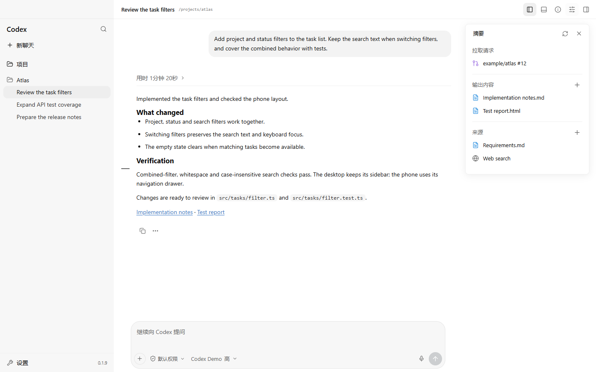
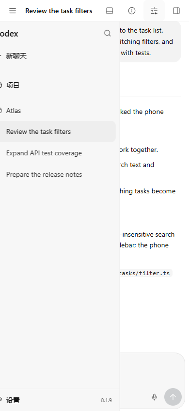

<div align="center">

# Codex Remote

**Your Codex Desktop workspace, in a browser.**

Continue chats, review changes and answer native questions from your phone or another computer.

[English](README.md) · [简体中文](README.zh-CN.md)

[](https://github.com/CoralFlower325/Codex-remote/actions/workflows/ci.yml) [](https://github.com/CoralFlower325/Codex-remote/releases)  [](LICENSE)

[Quick start](#quick-start) · [User guide](docs/guide.md) · [Documentation](docs/README.md) · [Releases](https://github.com/CoralFlower325/Codex-remote/releases)

</div>



<p align="center"><sub>Actual frontend with synthetic demo data. Desktop capture: 1440 × 900; phone: 390 × 844 CSS pixels.</sub></p>

## One Workspace, Across Screens

Remote connects to **Codex Desktop's own App Server**, so your browser and Desktop share chats and live activity. A responsive phone layout, resizable desktop panels and on-demand history keep the workspace usable on both screens.

| Continue the work | Inspect the result | Stay in control |
| --- | --- | --- |
| Shared chats, projects, native models, reasoning levels and skills | Folded execution records, unified/split diffs and file/web previews | Per-chat permissions, supported approvals and native question forms |
| Main-chat queues, steering, temporary side chats and subagent viewers | Conversation outline and a summary panel for PRs, outputs and sources | Reconnection without replaying uncertain actions, opt-in Web Push and version checks |

<details>
<summary><strong>Phone workspace and change review</strong></summary>

<p align="center">
  
  
</p>

Mobile attachment and conversation-index controls use 36px sizing. Desktop keeps its own control sizes. See the [layout guide](docs/guide.md#responsive-layout) for viewport rules and device acceptance limits.

</details>

## Quick Start

Use **Windows 10/11 or macOS**, **Node.js 22.19+ with npm**, and an installed, signed-in Codex Desktop.

### 1. Enable Desktop Sync

Save your work and fully quit Codex Desktop once, then launch it with its debug endpoint bound to loopback.

<details open>
<summary><strong>Windows · PowerShell</strong></summary>

For a Windows Store installation:

```powershell
$package = Get-AppxPackage -Name "*Codex*" | Select-Object -First 1
& (Join-Path $package.InstallLocation "app\Codex.exe") --remote-debugging-port=9229 --remote-debugging-address=127.0.0.1
```

For another installation, pass the same arguments to its actual `Codex.exe`. Package paths can vary.

</details>

<details>
<summary><strong>macOS · Terminal</strong></summary>

```bash
open -a Codex --args --remote-debugging-port=9229 --remote-debugging-address=127.0.0.1
```

</details>

Keep port **9229 private**. The [setup guide](docs/guide.md#2-enable-desktop-synchronization) includes debug-target verification.

Ordinary Codex launches do not necessarily enable this endpoint. Launch with the
arguments above, or use an existing launcher configured to supply them.

### 2. Install And Run

```bash
git clone https://github.com/CoralFlower325/Codex-remote.git
cd Codex-remote
```

Run the setup command for your host, then start Remote:

| Windows | macOS |
| --- | --- |
| `npm run setup:windows` | `npm run setup:macos` |
| `npm start` | `npm start` |

Setup installs locked dependencies, builds the app and asks for an access password. Initial password setup is accepted only on the host.

Open **http://127.0.0.1:4545** and sign in. For shared Desktop live events, `/health` must report `codex: ready` and `transport: desktop`. A `standalone` transport uses a separate App Server and does not share Desktop live events.

### 3. Use It From Another Device

Publish the protected web origin through an **HTTPS tunnel or reverse proxy**. The Windows Cloudflare helper configures a stable hostname; macOS tunnel setup has separate requirements.

[Public access setup](docs/guide.md#public-access) · [Windows start/stop](docs/guide.md#windows-start--stop) · [macOS start/stop](docs/guide.md#macos-start--stop)

After setup, the host's `Start Remote.cmd` / `Stop Remote.cmd` or `.command` files manage background operation. Windows needs no persistent console window. Stopping Remote leaves Codex Desktop open. Windows controls also manage the configured Tunnel task; macOS manages an independent tunnel separately.

The optional [Desktop Manager](docs/desktop-manager.md) detects installed hosts and adds local start/stop,
actionable health checks, password/device administration and confirmed version updates, with a Windows notification-area icon
or macOS top menu-bar icon. Updates show Chinese stages, percentage progress and elapsed
time. Standard installations prefer verified prebuilt runtimes; customized source
installations retain isolated builds. Interrupted host installs recover when the manager restarts.
Manager 0.2.2 adds a separate Windows self-update flow with verified downloads and
program/settings backups; unsigned Mac builds offer installer downloads instead.
Choose the existing installation; closing the window
keeps it in the tray. Releases provide unsigned installers. Live macOS GUI acceptance
remains pending.

## Built For Ongoing Sessions

Native Codex runtime errors remain visible in their turns, including available
HTTP status codes and Codex retry state. See [runtime errors](docs/native-runtime-errors.md).

- **Read long conversations.** Bounded history pages preserve reading position; execution bodies load when expanded.
- **Edit after stopping.** Edit the original message of the latest stopped turn, then confirm resending with its attachments and skills. Conversation history is replaced; existing file changes remain.
- **Handle native questions.** Explicit answers work in main and temporary chats. Pending badges reflect observed questions; they are not a complete search of unread history.
- **Keep context close.** Inspect files, previews, PR attachments, outputs and sources beside the conversation. Summary coverage depends on the native resource metadata provided.
- **Choose when to update.** An already current check leaves the page intact. A real update shows release notes before confirmation; main-chat text drafts survive, while temporary chats, unsent images and skill selections clear.
- **Receive device notifications.** Opt into completed-task, question and approval Web Push. Payloads include titles and bounded reply/question previews; they may appear on a lock screen.
- **Open a host terminal.** Remote-owned interactive shells run as the host user, separately from Desktop terminals and outside model permission profiles.

[Full user guide](docs/guide.md) · [Notifications](docs/guide.md#device-notifications) · [Updates and recovery](docs/manual-version-update.md) · [Summary panel](docs/native-summary-panel.md)

## Support And Boundaries

| Surface | Verification status |
| --- | --- |
| Windows | Signed-in Desktop live acceptance |
| macOS | Build, tests, shell syntax and LaunchAgent CI; signed-in integration, login persistence and legacy tunnel acceptance pending |
| Phone browsers | Responsive Chromium/Windows WebKit checks; physical iPhone Safari/Home Screen, keyboard and Wi-Fi/5G acceptance pending |
| Linux | CI build and tests; Desktop integration unvalidated |

The interface currently uses **Simplified Chinese**. Internal Desktop interfaces can change between releases. Some approval forms, real native question submission, actual dictation and physical OS notification display still need dedicated live acceptance. Model/project catalogs currently read their first requested page; model defaults can differ from global overrides.

Remote is for **one trusted operator controlling their own machine**. Use a strong password and HTTPS. Keep `.env`, `data/`, credentials, logs and debug ports private. Public app caches exclude conversations and APIs; the separate authenticated device snapshot has bounded retention. Review [Security](SECURITY.md) and the [complete limits](docs/guide.md#known-limits) before exposing a host.

## Documentation And Contributing

| Looking for | Start here |
| --- | --- |
| Installation, configuration and everyday controls | [User guide](docs/guide.md) / [中文指南](docs/guide.zh-CN.md) |
| Hosting, mobile networks and recovery | [Operations chapters](docs/guide.md#loading-and-mobile-networks) |
| Acceptance evidence and implementation notes | [Documentation index](docs/README.md) |
| Development and pull requests | [Contributing](CONTRIBUTING.md) |
| Current work and release procedure | [Maintainer handoff](docs/maintainer-handoff.md) |
| Version history | [GitHub Releases](https://github.com/CoralFlower325/Codex-remote/releases) |

Each validated functional batch publishes a versioned GitHub Release. Documentation-only changes keep the application version.

## Credits And License

[MIT](LICENSE). Based on [Bones-star588/codex-remote](https://github.com/Bones-star588/codex-remote), with workspace and review UI references from [Bones-star588/codex-webui](https://github.com/Bones-star588/codex-webui), copyright 2026 lezi-fun. Windows port and this distribution by [CoralFlower325](https://github.com/CoralFlower325).

Built with React, TypeScript, Vite, Express, WebSocket and Lucide. See [Third-party notices](THIRD_PARTY_NOTICES.md).

Community project, not affiliated with or endorsed by OpenAI. Codex and related branding belong to OpenAI; the software license grants no trademark rights.
