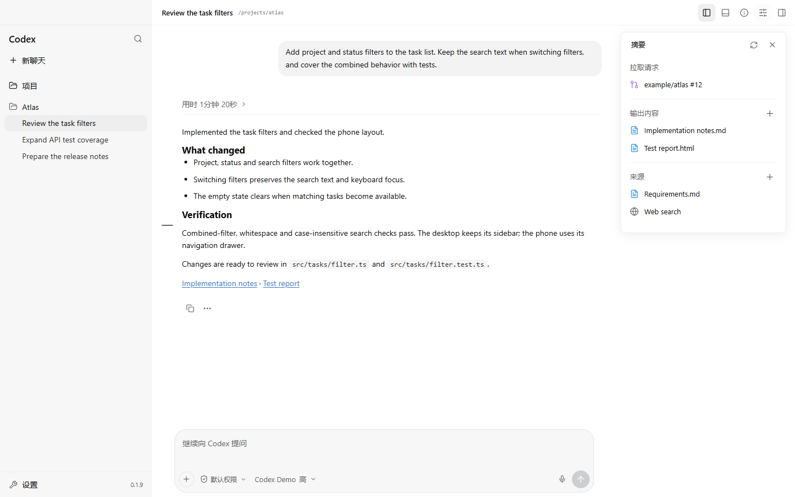
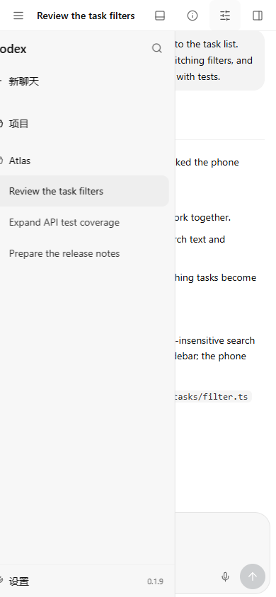

<div align="center">

# Codex Remote

**在浏览器里，继续你的 Codex Desktop 工作。**

通过手机或另一台电脑继续会话、审阅变更，并回答原生提问。

[English](README.md) · [简体中文](README.zh-CN.md)

[](https://github.com/CoralFlower325/Codex-remote/actions/workflows/ci.yml) [](https://github.com/CoralFlower325/Codex-remote/releases)  [](LICENSE)

[快速开始](#快速开始) · [使用指南](docs/guide.zh-CN.md) · [文档索引](docs/README.md) · [版本记录](https://github.com/CoralFlower325/Codex-remote/releases)

</div>



<p align="center"><sub>实际前端，虚构演示数据。桌面截图为 1440 × 900，手机为 390 × 844 CSS 像素。</sub></p>

## 同一个工作区，适应不同屏幕

Remote 连接 **Codex Desktop 自己的 App Server**，让浏览器与桌面共享会话和实时活动。手机使用独立的响应式布局，桌面面板可调整宽度，长历史按需加载，两端都保留适合自己的操作空间。

| 继续工作 | 检查结果 | 掌握操作 |
| --- | --- | --- |
| 共享会话、项目、原生模型、推理强度与技能 | 折叠执行记录、统一或并排 diff、文件及网页预览 | 会话级权限、受支持的审批和原生提问表单 |
| 主会话队列、引导、临时侧聊与子智能体查看 | 回合导航，以及汇集 PR、输出和来源的摘要面板 | 断线恢复不重放结果不确定的操作，按需开启 Web Push 和检查更新 |

回复支持行内和独立 LaTeX 公式，长公式可横向滚动；公式渲染器与字体按需加载。

侧栏当前文件随主机保存自动更新，保留阅读位置；PDF 和 Office 更新保留页码与缩放。隐藏预览后停止监听。

<details>
<summary><strong>手机工作区与代码审阅</strong></summary>

<p align="center">
  
  
</p>

手机附件和回合索引控件采用 24px，模型控件保持 36px。输入区始终只有一个主操作：运行中的任务在输入为空时显示停止，添加文字、文件或技能后切换为发送。运行中发送会立即显示在输入框上方的原生待发/引导条，可编辑、引导或关闭排队；会话历史入口紧靠发送按钮左侧。桌面附件和索引也采用紧凑尺寸。视口规则和设备验收边界见[布局指南](docs/guide.zh-CN.md#响应式布局)。

</details>

## 快速开始

需要 **Windows 10/11 或 macOS**、**Node.js 22.19+（含 npm）**，以及已安装并登录的 Codex Desktop。

### 1. 开启桌面同步

先保存工作并完全退出一次 Codex Desktop，再通过调试参数启动，将调试端口绑定到本机回环地址。

<details open>
<summary><strong>Windows · PowerShell</strong></summary>

Windows 商店安装版：

```powershell
$package = Get-AppxPackage -Name "*Codex*" | Select-Object -First 1
& (Join-Path $package.InstallLocation "app\Codex.exe") --remote-debugging-port=9229 --remote-debugging-address=127.0.0.1
```

其他安装方式请向实际的 `Codex.exe` 传入相同参数；安装包路径可能有所不同。

</details>

<details>
<summary><strong>macOS · 终端</strong></summary>

```bash
open -a Codex --args --remote-debugging-port=9229 --remote-debugging-address=127.0.0.1
```

</details>

**9229 端口必须保持私有**。[安装指南](docs/guide.zh-CN.md#2-开启桌面同步)提供调试页面的检查方法。

普通启动 Codex 不保证开启此端点，需使用上述参数启动，或使用已经配置这些参数的启动器。
Windows 与 macOS 上，Remote 还会从当前已安装、正在运行的 Codex/ChatGPT 顶层进程读取
回环调试端口；启动器选择其他端口时无需再把同一个端口写进 `.env`。

### 2. 安装并启动

```bash
git clone https://github.com/CoralFlower325/Codex-remote.git
cd Codex-remote
```

根据主机系统执行安装命令，再启动 Remote：

| Windows | macOS |
| --- | --- |
| `npm run setup:windows` | `npm run setup:macos` |
| `npm start` | `npm start` |

安装会按锁文件安装依赖、构建应用，并要求设置访问密码。首次密码初始化仅接受主机上的请求。

打开 **http://127.0.0.1:4545** 并登录。`/health` 应显示 `codex: ready` 和 `transport: desktop`。Remote 只使用 Desktop 原有 App Server；桌面桥不可用时保持离线并重连，不启动独立 App Server，也不自动重发失败的消息。

### 3. 从另一台设备访问

通过 **HTTPS 隧道或反向代理**公开受保护的网页入口。Windows Cloudflare 助手可配置固定域名；macOS 隧道有独立的安装要求。

[公网访问配置](docs/guide.zh-CN.md#公网访问) · [Windows 开关](docs/guide.zh-CN.md#windows-开启与关闭) · [macOS 开关](docs/guide.zh-CN.md#macos-开启与关闭)

安装完成后，主机上的 `Start Remote.cmd` / `Stop Remote.cmd` 或 `.command` 文件管理后台运行，Windows 无需常驻终端。关闭 Remote 会保留 Codex Desktop；Windows 开关也管理已配置的 Tunnel 任务，macOS 的独立隧道需单独管理。

可选的[本机管理器](docs/desktop-manager.zh-CN.md)自动探测安装目录，提供启停、诊断修复、密码和设备管理与确认后的版本更新，
Windows 常驻右下通知区域，macOS 常驻顶部菜单栏。
更新显示中文步骤、百分比和耗时；标准安装优先使用校验后的预构建运行包，
源码定制安装保留隔离构建。管理器重启后可恢复中断的安装。
选择现有安装目录，关闭窗口后继续常驻。Release 提供未签名安装包；
macOS GUI 的实机验收仍待完成。

Remote **0.2.29** 为当前版本，配套管理器 **0.2.7**。
各主机实际安装版本以部署验收记录为准。请手动下载安装包覆盖旧管理器，
选择原主机目录重试；单独更新 Remote 不能替换旧管理器内置的更新器。
[管理器下载](docs/update-downloads.md)优先走项目自有公共分发，另有官方 GitHub 备用地址。
分发可达时，标准运行包更新无需直连 GitHub，也不运行 Git/npm；源码定制更新仍需
Git/npm 网络，实际主机与网络仍需单独验收。
管理器自更新仍暂停，**0.2.0AU** 开发线独立保留，不进入正式发布；
签名、公证及恢复开发的条件见[断点记录](docs/manager-self-update-checkpoints.md)。

## 为持续工作的会话准备

Codex 原生运行错误会保留在对应轮次，展示已有的 HTTP 状态码和原生重试状态。
详见[运行时错误说明](docs/native-runtime-errors.md)。

- **阅读长会话**：历史有界分页，保留阅读位置，展开执行记录时才加载详细正文。
- **发送 PDF 与重开任务**：上传 PDF 后可在草稿旁预览，通过主机文件引用交给任务使用；任务链接支持刷新恢复、分享和浏览器前进后退。详见[附件与限制](docs/guide.zh-CN.md#pdf-附件)。
- **停止后编辑消息**：修改最新被停止轮次的原始消息，确认后保留附件和技能重新发送；替换对话记录，保留已执行的文件修改。
- **处理原生提问**：主会话和临时侧聊均需明确提交答案；待答标识反映已发现的问题，不是对未读历史的完整检索。
- **随手查看上下文**：待发送图片在输入框上方预览，切换会话保留各自草稿的图片与技能；在对话旁查看文件、PR 附件、输出与来源，摘要覆盖取决于原生资源元数据。
- **验收文档成果**：主机安装 LibreOffice 后，可直接翻页预览 Word、Excel、PowerPoint，并在同一面板下载未改动的原文件。详见[格式与限制](docs/guide.zh-CN.md#文件与网页预览)。
- **决定何时更新**：已是最新版时保留页面；前端更新前展示摘要并等待确认。主会话恢复文字、已上传文档引用、技能及容量内的图片；无法恢复的附件明确提示。临时侧聊仅保存在内存。
- **远程更新后端**：设置中检查当前连接的 Windows x64 或 Apple Silicon Remote，新版只显示版本号和更新按钮；映射更新进度，成功后自动刷新配套网页。详见[网页后端更新](docs/web-backend-update.md)。
- **保留原生对话上下文**：可以只发送一个技能，两端均保留可见消息；同轮引导不移动计时位置，处理时长继续从该轮最初开始计算。
- **接收设备通知**：按需开启任务结束、提问和审批 Web Push，载荷含标题及有限长度的答复或提问预览，可能显示在锁屏上。
- **自动任务**：侧栏管理 Desktop 原生自动任务，两端共享任务、计划、项目与运行会话。持久化和执行由 Desktop 负责；继续现有聊天的任务仍需在 Desktop 手动立即运行。
- **打开主机终端**：Remote 独立管理的交互式 shell 以宿主用户身份运行，与 Desktop 终端分开，不受模型权限配置限制。

[完整使用指南](docs/guide.zh-CN.md) · [设备通知](docs/guide.zh-CN.md#设备通知) · [更新与恢复](docs/manual-version-update.md) · [摘要面板](docs/native-summary-panel.md)

## 支持范围与边界

| 范围 | 验证状态 |
| --- | --- |
| Windows | 已登录 Desktop 的实机验收 |
| macOS | 构建、测试、shell 语法与 LaunchAgent CI；登录后集成、登录自启及旧隧道仍待实机验收 |
| 手机浏览器 | Chromium / Windows WebKit 响应式检查；真实 iPhone Safari、主屏幕应用、键盘及 Wi-Fi/5G 验收待完成 |
| Linux | CI 构建与测试；桌面集成未验证 |

界面目前为**简体中文**。Desktop 内部接口可能随版本变化。部分审批表单、真实原生答案提交和系统通知显示仍需专项实机验收。模型与项目目录目前只读取首次请求页，模型默认值可能与全局覆盖配置不同。

Remote 面向**可信操作者控制自己的电脑**。使用强密码与 HTTPS，保持 `.env`、`data/`、凭据、日志和调试端口私有。公共应用缓存不包含会话与 API；独立的已认证设备快照有容量和时效限制。公开主机入口前请阅读[安全说明](SECURITY.md)和[完整限制](docs/guide.zh-CN.md#已知限制)。模型与项目目录会沿原生游标读完整快照，并在重连时刷新；模型默认值仍可能受全局配置覆盖影响。

## 文档与参与贡献

| 需要了解 | 从这里开始 |
| --- | --- |
| 安装、配置和日常操作 | [中文指南](docs/guide.zh-CN.md) / [English guide](docs/guide.md) |
| 托管、手机网络与恢复 | [运行维护章节](docs/guide.zh-CN.md#加载与手机网络) |
| 验收证据与实现说明 | [文档索引](docs/README.md) |
| 开发与 Pull Request | [贡献指南](CONTRIBUTING.md) |
| 当前工作与发布流程 | [维护交接](docs/maintainer-handoff.md) |
| 版本历史 | [GitHub Releases](https://github.com/CoralFlower325/Codex-remote/releases) |

每个验证完成的功能批次发布对应版本的 GitHub Release，文档更新保持应用版本不变。

## 致谢与许可证

[MIT](LICENSE)。基于 [Bones-star588/codex-remote](https://github.com/Bones-star588/codex-remote)，工作区与审阅界面参考 [Bones-star588/codex-webui](https://github.com/Bones-star588/codex-webui)，版权 2026 lezi-fun。Windows 移植及本发行版由 [CoralFlower325](https://github.com/CoralFlower325) 维护。

使用 React、TypeScript、Vite、Express、WebSocket 和 Lucide。完整声明见[第三方声明](THIRD_PARTY_NOTICES.md)。

本项目由社区独立维护，与 OpenAI 无隶属或背书关系。Codex 及相关品牌属于 OpenAI；软件许可证不授予商标使用权。
