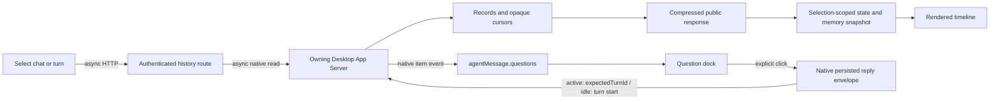

# History payload and native-question investigation

Date: 2026-10-29. All recorded content samples are counts/timings; private
conversation bodies, machine identifiers, session credentials and screenshots
are excluded.

This is historical 0.1.4 evidence. Its latest-turn question limitation is
superseded by the observed cross-turn question index in [0.1.9](pr-6-review.md).
For supported behavior, read the [current guide](guide.md#native-questions-and-history-details).

## Reproduction and expected behavior

The reported regression affects chat switching, older history, and outline
jumps. New async native questions appear as fallback text instead of answerable
controls. Expect bounded history that retains native cursors, complete visible
conversation, expandable original execution output, and explicit answers that
reach the owning Desktop turn.

## Hypotheses, instrumentation and first divergence

1. Native Desktop reads are slow. Read-only HTTP diagnostics measured native
   goal/queue reads at 3–36 ms; bounded host history was typically 5–95 ms.
   This is not the first demonstrated bottleneck.
2. History transfers folded execution bodies and the browser abandons a healthy
   response. A sampled initial history response was approximately 655 KB before
   compression, 164 KB on the wire; public first byte was about 5.1 seconds and
   completion 11.6 seconds, versus about 84 ms locally. The old first attempt
   aborted at six seconds through the body and retried. A tiny public goal read
   also took about 6.7 seconds, so payload size is not the only network cost.
3. Missing questions are unsupported data, not a delayed approval. The existing
   approval dock handles item/tool/requestUserInput, whereas current Desktop
   emits asynchronous questions on agentMessage.questions. The current native
   schema and emitted records contain that field; the old UI renders text only.

Contributor diagnostic instrumentation logged sizes, counts, duration, cache state and errors, never
question text, answers, command output or authentication values. A synthetic
340 KB command output reproduced the initial-transfer defect before the fix.
Its bounded response now stays below 4 KB while retaining user/reply text.

## Result parity and minimal fixes

| Correlation | Native source | Old Remote | Revised Remote |
|---|---|---|---|
| Same command item / turn | Full output | Downloaded while folded | Preview first; exact original on expansion |
| Same conversation items | Complete prose and IDs | Complete but heavy transport | Prose/IDs/cursors unchanged |
| Same file-change item | Full diff | Review consumes diff | Full diff retained for review |
| Same async message / question index | Title, options, native ID | Text fallback only | Options plus multiline custom answer |
| Same synthetic 11-second read | Successful response | Aborted at six seconds | Completes one download |

Only command/tool bodies and unrendered reasoning content are projected from
history transport. Unknown item kinds and file diffs remain complete. The
new authenticated, no-store detail route performs a single thread/items/read
and changes no native state. Timeline and command-inspector expansions share
that contract, with cancellation and explicit retry. Native history storage
is unchanged. Initial history, timing and dock body deadlines are 15 seconds;
existing bounded retries and selection cancellation remain.

The question dock uses the native message ID plus original array index. Its
first option is selected but never sent automatically; free text is always
available. Explicit submission uses send_user_message_question_reply. Active
turns steer with expectedTurnId; idle turns use the existing native start path,
without going through queued messages. Persisted Desktop replies remove the
matching questions. Failed drafts remain in mounted memory. Displayed user
answers show the question and answer instead of internal envelope markup.

## Open-source assessment

- [openai/codex](https://github.com/openai/codex), Apache-2.0, approximately
  131,470 stars at research time, pushed 2026-10-29: official request handler,
  generated schema and native tests are suitable protocol references. Installing
  its full native stack or copying its UI would add an incompatible second
  architecture. Use the contract with the existing Desktop bridge.
- [CoralFlower325/Codex-remote](https://github.com/CoralFlower325/Codex-remote),
  MIT: existing React/Node architecture and approval UI are the smallest
  compatible integration point. The installed Desktop's generated schema and
  persisted reply format were checked separately because protocol versions vary.
- [lezi-fun/codex-webui](https://github.com/lezi-fun/codex-webui), MIT,
  approximately 37 stars, pushed 2026-10-20, no open issues returned at research
  time: a separate frontend would introduce state synchronization and adaptation
  work. An empty issue list is not evidence of full compatibility.

No dependencies were installed and no third-party UI source was copied.
Reference implementation is preferred over importing another app or inventing
an answer protocol. The implementation is original code using native contracts.

## Verification and limits

- Client/server type checking, production build and 355 tests / 59 files passed
  before integration with the newly merged upstream release.
- Tests cover payload identity/immutability, complete prose/questions/diffs,
  auth/query/native errors, slow-body completion, detail expansion/cancellation,
  native answer indices/format, selected and free text answers, cross-client
  persisted answers and retained failed drafts.
- Native Chrome UI checked synthetic 402×874 and 874×402 frame viewports.
  Multiline text did not submit itself. A synthetic failed submission preserved
  the draft; the second click received two correctly wrapped answers with the
  newline retained. The landscape card scrolled to its submit control. Expanding
  a command loaded and displayed its complete synthetic native output.
- No real native question was answered on the user's behalf. Physical iOS
  keyboard, live approval/answer submission and actual cellular performance
  need separate acceptance.
- Questions outside the loaded bounded latest-turn history and temporary
  side-chat forms are not claimed complete. Network tail latency remains an
  external limit; a 15-second timeout is mitigation, not a tunnel repair.

### Contributor integration and live deployment check

The following macOS deployment observations were supplied by the contributor.
They have not been repeated by the maintainer on a signed-in Mac.

The original PR was merged while this work was in progress. Integrated upstream
0.1.3 (`1e131ce`), retaining its stale-queue guard alongside the longer read
budget. Client/server type checking, all 363 tests / 59 files and the production
build passed on the integrated tree.

The existing macOS service was restarted in place. Its health reported the
Desktop transport ready. Three real bounded chats, their older pages and
outline windows returned successfully through the local authenticated routes.
A same-call projection log measured 240 records / 120 deferred items at
1,640,478 input bytes and 219,410 output bytes (about 87% less). Native storage
was unchanged. Five original detail reads matched their requested item/turn/type
identities and returned full native bodies.

Public and local HTML and entry-module hashes matched the deployed build.
Unauthenticated detail reads returned 401 on both origins. Public transport was
still variable: one compressed history response took about 10.3 seconds for
47 KB on the wire, while a tiny goal read and some asset requests timed out.
An IPv4 HTTP/1.1 entry-module read succeeded and matched the build in about
7.7 seconds. These are real remaining network-tail observations, not proof of
instant chat switching or resolved tunnel behavior. A subsequent Chrome public
entry showed the authentication shell; no real account password or answer was
entered for acceptance.

### Maintainer review for 0.1.4

- Scoped both loaded execution bodies and read errors to their owning thread and
  summary. A full live item supersedes an old detail-read error immediately.
  Cancelled or closed reads cannot apply late results.
- Removed unconditional byte-size logging from the history projection. Measuring
  it serialized the full input and compact output on every page before the HTTP
  serializer ran. Deferred bodies are now omitted without this extra traversal.
- The complete suite passes 366 tests across 59 files; TypeScript and the
  production build pass. HTTP router tests use Node HTTP so OS-assigned ports
  cannot randomly collide with Fetch's forbidden-port list.
- Chromium and Windows WebKit pass synthetic acceptance at 2560x1440,
  402x874, 320x568 and 874x402. Checks cover explicit submission, unsent defaults,
  multiline answers, failure draft retention, active-turn steering, idle-turn
  start, partial persisted Desktop answers and bypassing the normal queue.
  Folded bodies cause no detail read; expansion, retry, reopening and independent
  command/tool details preserve their expected identities and request counts.
  No page exceptions or horizontal overflow were observed.
- Screenshots and mutations use an isolated synthetic origin. No real model
  request, user answer, Goal mutation or push notification was sent.
  Physical iOS, live native answers and mobile network tail latency remain
  separate acceptance.
