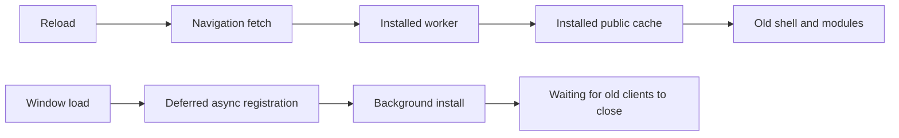

# Manual version update investigation

## 0.1.8 Behavior

The loaded main-entry script identifies the page build. A fresh `/version.json`
comparison uses both package version and build ID; the current service-worker
controller is only a fallback when no main shell exists (the recovery page).
An already current check returns without registration, activation or reload.
An old page under an already new controller still reloads after explicit update.

Settings and recovery use two steps: check, show release summaries, then confirm
the real update. Installation/build verification and failure preservation remain.
A tab-session receipt displays the completed summary after reload and clears on
acknowledgement; no conversation or authentication data is in this receipt.
Public bounded release metadata comes from `src/shared/release-notes.ts` and
is included in the uncached version manifest. Same-version rebuilds are detected.

The dated investigation below describes the original implementation; references
to latest-version refresh are historical and superseded by this behavior.

## Bug summary and call chain

An already installed client can continue displaying the old app after deployment
and ordinary reload. Expected: an explicit refresh can load a complete new build.
Observed baseline: cached navigation returns the installed shell immediately;
registration has no user-facing update action or waiting-worker activation handler.
The reporting phone's actual worker/install state has not been inspected.

## Hypotheses, instrumentation and parity

1. Waiting-worker lifecycle: source and VM behavior confirm that ordinary
   navigation does not reach the network and no explicit activation handler exists.
2. Incomplete precaching on a slow connection: public asset probes have timed out;
   this remains a possible phone-specific cause, not a confirmed device diagnosis.
3. Old deployment/edge shell: public shell probes matched the deployed build at
   the preceding release. This does not establish the reporting device's state.

Baseline VM probe, correlated by the same navigation URL and cache key `/`:

| Case | Installed-cache result | Network reads | Final result |
| --- | --- | --- | --- |
| Reload `/` | `installed-old-shell` | 0 | Old shell |
| Waiting-worker message support | No handler | N/A | No manual activation |
| Navigate `/update.html` | Not intercepted | Browser network | Recovery route possible |

The first proven divergence is the cache/update lifecycle, not chat transport.
Registration now logs worker states instead of swallowing errors. Manual-update
logs contain stage and public version/build identity only; no chat or auth data.

## Open-source review (2026-10-29)

- [Workbox](https://github.com/GoogleChrome/workbox): MIT, about 13k stars,
  repository updated 2026-10-20, about 85 open issues/PRs. Its workbox-window
  package documents waiting-worker updates and has dedicated source/tests.
  Direct adoption adds a runtime dependency for behavior the current worker
  can expose through native messages.
- [vite-plugin-pwa](https://github.com/vite-pwa/vite-plugin-pwa): MIT, about
  4.3k stars, updated 2026-10-09, about 191 open issues/PRs. Current package
  metadata supports Node 20.19+ and Vite 6, compatible with this Node 22/Vite 6
  project. It adds Workbox build/window integration. Open reports include
  generation integration and Trusted Types; those reports do not establish
  a defect in this existing plain Vite app.
- PWABuilder's older pwa-update was also checked: about 70 stars, last push
  2022, and license metadata `NOASSERTION`; it was not selected.

Direct integration or replacing the existing build plugin would add lifecycle
and push compatibility work. Recommended: implement the narrow explicit update
action with browser APIs while retaining the existing worker, push handling,
and atomic public precache. No dependency was installed or third-party code copied.

## Minimal implementation

- Settings opens a compact update dialog with current version, progress and retry.
- Fresh `/version.json` identifies the deployment; no-store plus a query nonce
  avoids both the existing worker and ordinary HTTP reuse.
- Register/update with `updateViaCache: none`, await installation, confirm that
  worker's build through a MessageChannel, explicitly activate, then wait for
  controller change before reloading. Failed installs retain the working version.
- Bound the operation to 120 seconds and worker build replies to five seconds;
  cancellation removes listeners and prevents a delayed reload.
- Preserve login, session-storage main-chat text drafts, push subscriptions and private caches.
  Reloading clears temporary side chats, unsent images and skill selections;
  the dialog states this before the user starts the update.
  Activation messages accept only same-origin clients. Manual activation retains
  old public modules for other open tabs; natural activation performs old-cache cleanup.
- `/update.html` is a small independent build entry with inline styling and no
  workspace preload. Old workers bypass it, enabling this first manual upgrade.
  Use the same browser/PWA storage context; updating Safari does not prove a
  separately installed web app has updated.

## Validation and limits

Automated coverage reproduces cached navigation, checks recovery/metadata bypass,
cross-origin message rejection, explicit activation, old-tab public assets,
complete/failed installation, build mismatch, latest-version refresh, controller
handover, cancellation, deadlines, unsupported workers and recovery navigation.
Type checks, complete tests and the production build are run before deployment.
Physical iOS Safari/PWA acceptance is separate. An old shell cannot display a new
settings button before its first upgrade; the recovery route supplies that bridge.

Native Chrome UI acceptance on localhost: opened `/update.html`, observed tool
version 0.1.8, clicked the real update button, and verified successful navigation
back to the application login screen. No authentication credentials were entered;
the authenticated settings dialog and physical iPhone update remain unverified.
