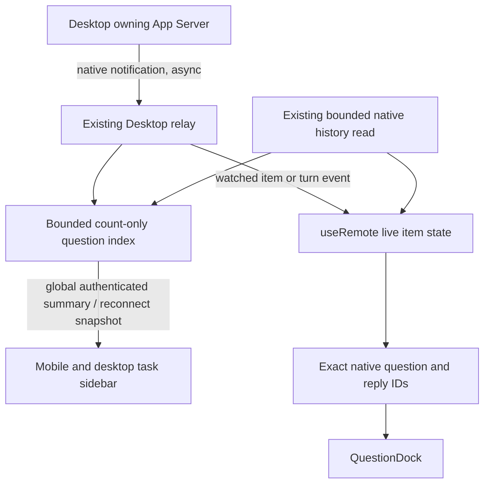

# Native question visibility and sidebar indicators

## Symptom and reproduction

A freshly issued native question can be absent from Remote. An unanswered question
also disappears when a Goal moves to another turn. The sidebar originally only
marked blocking approvals and offered no asynchronous question indicator.

## Call chain

## Hypotheses and first divergence

1. Current-turn selection hides pending questions: confirmed. A synthetic question
   with ID `synthetic-question` is present in source items, produces one card for
   its own turn, and produces zero for a subsequent active turn or null selector.
   Read-only native bounded pages also contained valid unanswered groups excluded
   by that selector. No private content or identifiers are recorded here.
2. Whole-turn messages are dropped: confirmed by an integration test using the
   native turn notification shape already handled by temporary chats. Both
   `turn/started` and `turn/completed` carry one embedded question, but the main
   reducer receives zero items and the dock renders zero question IDs. The test
   holds history reads pending, isolating the first divergence to event ingestion.
3. Invalid question format or prose inferred as an answer: no supporting evidence
   in sampled native payload shapes. No speculative native format rewrite added.

## Minimal changes

- Ingest embedded whole-turn items in main chat, keeping item bodies out of timing
  state and ignoring new window-external items during historical navigation. Merge
  whole-turn items in a single indexed pass rather than repeatedly copying history.
- Select all loaded unanswered questions by exact persisted IDs independently of
  active turn. Retain explicit answer submission, draft/error behavior, native
  steering and idle start. Reuse the same dock for temporary side chats.
- Keep a bounded server memory index of observed question/answer IDs. Broadcast
  only pending counts to all authenticated peers, including unselected chats;
  synchronize the summary at connect/replay and hydrate from existing history.
  Exact reply IDs prevent a stale history response resurrecting known answers.
- Add a visible **待回答** sidebar badge and accessible pending count on both
  layouts, including blocking native user-input requests. Ordinary approvals and
  running indicators retain their separate states.

## Verification

Regression tests cover embedded start/completion arrivals with pending HTTP
history, item-before-turn ordering, Goal continuation, later-turn and partial
answers, out-of-order history, unselected chat summaries, reconnect replacement,
malformed inputs, bounded memory, count-only global replay, both sidebar layouts
and preservation of older history navigation. UI acceptance uses synthetic data;
no real model turn, answer, Goal mutation or notification is sent.

## Limits

This is an observed-question index, not a complete server-side search of every
conversation. It is memory-only (1,000 chats; 1,000 pending and answered IDs each).
After restart or eviction, old questions outside loaded bounded history need a
native event or history read to become known. No extra startup task-history reads
or private question persistence is introduced. Physical iOS PWA behavior and real
native answer delivery remain separate live acceptance.

## Answer input and pending-question notifications

A synthetic Safari focus check correlated the same answer textarea before and
after CSS changes: before, computed font-size was 13px and focus outline was a
2px solid dark border; after, mobile font-size was 16px, outline-style none,
box-shadow none, with the existing light border retained. The macOS viewport
scale remained 1; this is not a physical-iOS keyboard acceptance claim. Only
answer fields change focus appearance; mobile composer text and user-initiated
page zoom retain their existing behavior.

Newly pending native question IDs trigger the existing opt-in server Web Push,
including chat name, up to 100 question characters and a link to that chat.
Repeated item/turn events and history hydration do not notify again. Blocking
native user-input requests also identify themselves as questions. Existing
ordinary-chat watch scope, subscription settings and retry policy remain in use.
Notification unit tests mock delivery; no real device push was sent for QA.

## Contributor-reported checks

These checks describe the contributor's candidate and separate installation.
They are not the maintainer's current deployment receipt. See
[the integration review](pr-6-review.md) for the accepted mainline batch.

- Deployment and task-only upstream candidate: 432 tests / 65 files pass;
  TypeScript and production builds pass in both trees.
- macOS Safari synthetic viewports: 402×874, 874×402, 320×568 and 1440×900;
  no horizontal page overflow. Sidebar badges are visible, question options and
  multiline input work, explicit synthetic submission clears the card and badge,
  and a short landscape dock scrolls to its submission control. Mobile and
  desktop focused answer inputs have outline-style none and box-shadow none;
  mobile input font is 16px while desktop sizing stays unchanged.
- The existing deployed service restarted once after its old process/listener
  exited. Ready Desktop transport, authenticated bounded native history, question
  summary connection snapshots and unauthenticated HTTP 401 are verified.
- No real model input, native answer, Goal mutation or push was sent in acceptance.
  Physical iOS focus/keyboard and OS push display remain unverified.
